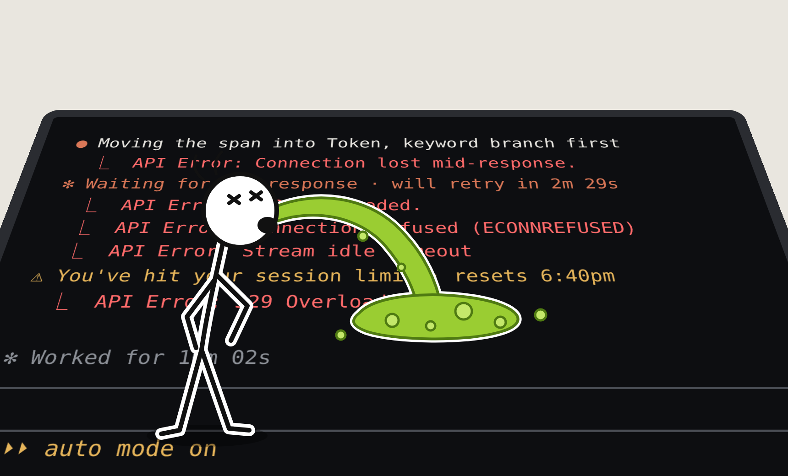
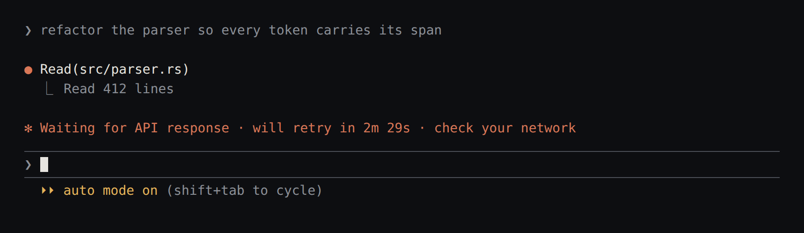
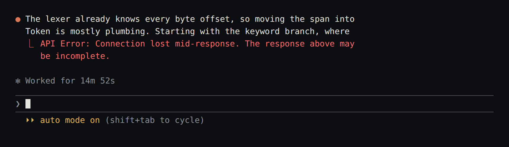
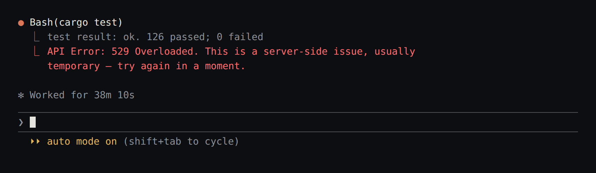
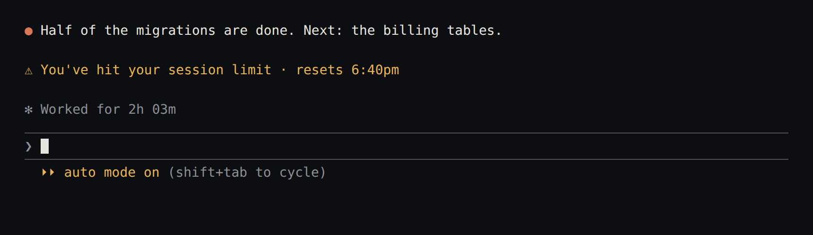

# claude-nonstop

You leave Claude Code on a long task, come back hours later, and find it stopped ten minutes in:

**Anthropic, please stop this bullshit.**

Until then, ([install](#install)) **claude-nonstop** won't let Claude Code sit idle over errors.

A cut-off turn resumes at once; outages, overloads and limits are waited out.

No wrapper, no polling: the StopFailure hook plus [`CLAUDE_CODE_MAX_RETRIES`](https://code.claude.com/docs/en/env-vars).

<table>
  <tr>
    <td> The network blinked. Now a retry countdown, then another one.</td>
    <td> The answer broke off mid-sentence. The turn is over.</td>
  </tr>
  <tr>
    <td> The API was overloaded for a minute. The turn is over.</td>
    <td> The limit reset at 6:40 pm. Nobody typed "continue".</td>
  </tr>
</table>

## Install

    curl -fsSL https://raw.githubusercontent.com/Darkwing4/claude-nonstop/main/install.sh | sh
    claude-nonstop install

`install` adds the StopFailure hook and `CLAUDE_CODE_MAX_RETRIES=1` to the `env` of `~/.claude/settings.json`; pick another count with `--max-retries N` (0 to 15). Run `claude` as usual. Also available as `cargo install claude-nonstop`. Add `--daemon` to `install` for a systemd user unit that keeps waits alive across closed panes and reboots.

## Compared with

|  | claude-nonstop | claude-auto-retry | unsnooze |
| --- | --- | --- | --- |
| Detection | hook, transcript | screen polling + hook | screen polling + hook + transcript |
| Built-in retry countdown | capped by `CLAUDE_CODE_MAX_RETRIES` | waited out | waited out |
| Runtime | one static binary | Node 18 | Node 20 |
| Terminals | tmux, zellij, headless | tmux | tmux, zellij, herdr, cmux, headless |
| Agents | Claude Code | Claude Code | 8 CLIs |

## Commands

    claude-nonstop status | logs -f
    claude-nonstop resume-now ID | cancel ID | message ID "text"
    claude-nonstop prompt add --at 7pm "run the tests" | prompt list
    claude-nonstop config list | config set notify.ntfy_topic alerts
    claude-nonstop doctor --fix | install --daemon --max-retries 2 | uninstall --purge

## Configuration

`~/.config/claude-nonstop/config.toml`; `claude-nonstop config list` prints every key with its default and source. Any key can be overridden with `CLAUDE_NONSTOP_<SECTION>_<KEY>`. Notifications go through notify-send, plus ntfy when a topic is set.

## Limitations

- Depends on StopFailure hook payload fields and the transcript format. Tested with Claude Code 2.1.287; `doctor` warns on newer versions.
- `CLAUDE_CODE_MAX_RETRIES` also applies to subagents. A subagent that gives up does not fire StopFailure; the main agent sees a failed tool call and decides what to do.
- It types into your terminal. It never types over a running turn, over text you are entering, or into a pane that no longer runs Claude Code, and it never presses Enter on a menu it cannot read.
- Linux only.

## License

[GPL-3.0](LICENSE)
